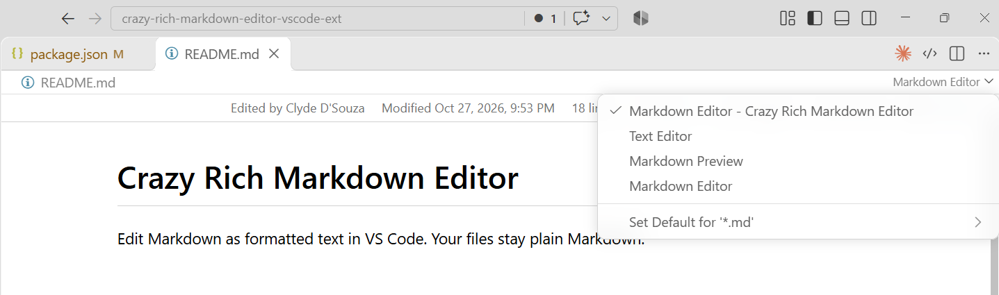
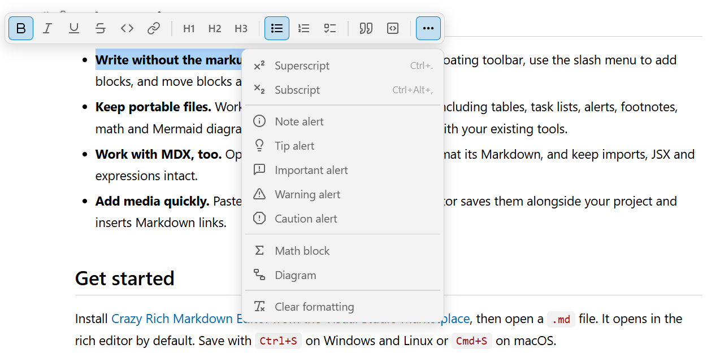
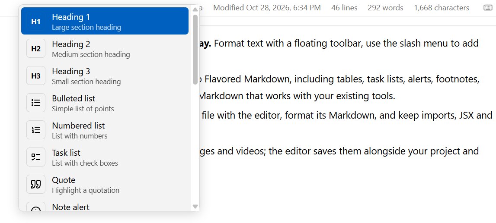
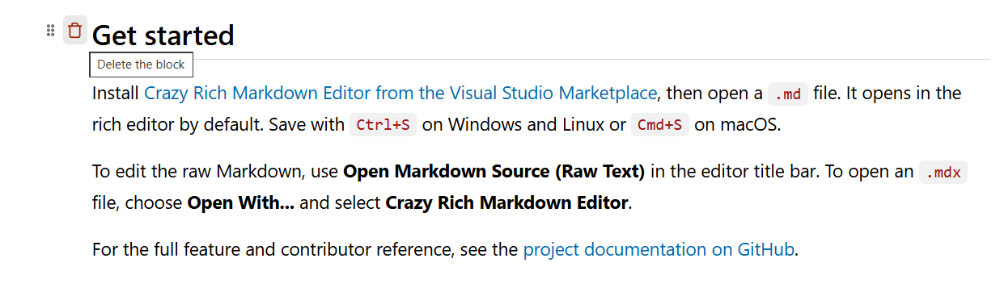
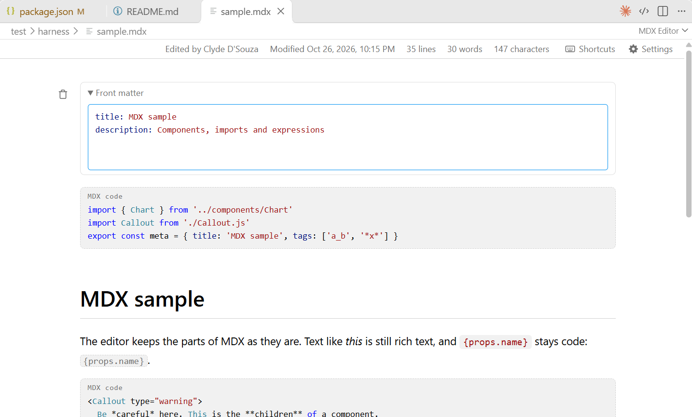

# Crazy Rich Markdown Editor

Edit Markdown as formatted text in VS Code. Your files stay plain Markdown.

## Why use it?

- **Write without the markup in your way.** Format text with a floating toolbar, use the slash menu to add blocks, and move blocks as you write.
- **Keep portable files.** Work with GitHub Flavored Markdown, including tables, task lists, alerts, footnotes, math and Mermaid diagrams. Save as Markdown that works with your existing tools.
- **Work with MDX, too.** Open an `.mdx` file with the editor, format its Markdown, and keep imports, JSX and expressions intact.
- **Add media quickly.** Paste or drop images and videos; the editor saves them alongside your project and inserts Markdown links. Select an image to edit its alt text and optional title without changing its preview size.

## Get started

Install [Crazy Rich Markdown Editor from the Visual Studio Marketplace](https://bit.ly/crmdxe), then open a `.md` file. It opens in the rich editor by default. To open an `.mdx` file, choose **Open in Crazy Rich Markdown Editor**. To edit the raw Markdown, click the **Text Editor** option from dropdown.

Start typing just like you would write a blog post in Medium or Confluence. You can highlight text to open the context menu which shows all the formatting options available. This editor supports  GitHub Flavored Markdown. Save with `Ctrl+S` on Windows and Linux or `Cmd+S` on macOS. 

In a new line, you can also type a forward slash (i.e. `/`) to see the formatting options.

You can also click the handle icon (6 dots icon) located at the left of the block to move the block around using drag and drop. You can also click the trash icon to delete the block.

Both markdown and mdx editors support have a toolbar at the top which show meta information like who modified this file last (using Git, if it exists) and when was it modified, and also character and word count. You can also reach for the extension settings from here and view the keyboard shorcut bindings from here. 

Frontmatter is supported at the start of the file with Yaml syntax highlighting available. In MDX files, JSX code is shown in a code snippet but not rendered.

For the full feature and contributor reference, see the [project documentation on GitHub](https://github.com/ClydeDz/crazy-rich-markdown-editor-vscode-ext/tree/main/docs).

# Credits

- Developed by [Clyde D'Souza](https://clydedsouza.net/)
