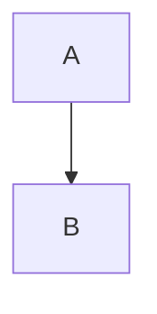

# Crazy Rich Markdown Editor

Select any text and a **floating toolbar** appears above it. This paragraph has *italic*, ~~strikethrough~~, `inline code` and a [link](https://example.com) to try things on.

## Lists

- Bullet one
- Bullet two
  - Nested bullet

- [ ] Open task
- [x] Done task

1. First
2. Second

> A quote with some wisdom in it.

```ts
// A typed greeting
const greeting: string = 'hello';
console.log(greeting.length + 42);
```



> [!NOTE]
> Useful information that users should know, even when skimming content.

> [!WARNING]
> Urgent info that needs immediate user attention to avoid problems.

Chemistry: H<sub>2</sub>O, math: E=mc<sup>2</sup>, and <ins>underlined text</ins>. Press <kbd>Ctrl</kbd> + <kbd>C</kbd>.

More text HTML: <b>bold</b>, <strong>strong</strong>, <i>italic</i>, <em>emphasis</em>, <mark>highlighted</mark>, <small>small print</small>, <del>removed</del>, <s>no longer</s>, <strike>legacy</strike>, <u>underlined</u>, <span>a span</span>, <abbr title="HyperText Markup Language">HTML</abbr>, <cite>A Book</cite>, <q>a quotation</q>, <dfn>a term</dfn>, <time datetime="2026-11-10">today</time>, <samp>build passed</samp>, <var>userName</var>, <code>inline()</code>, <tt>monospace</tt>, <a href="https://example.com">a raw link</a>, <ruby>漢<rp>(</rp><rt>kan</rt><rp>)</rp></ruby>, <bdo dir="rtl">abc</bdo>, a long<wbr>word, and a logo  in the text.

A line break sits here:<br>the text after it.

A footnote reference[^1].

[^1]: The footnote text.

| Name | Role     |
| ---- | -------- |
| Ada  | Engineer |
| Lin  | Designer |

## HTML blocks

The HTML blocks of the GFM spec keep their text, and the page shows them the way GitHub does.

<!-- A comment shows nothing in the page, and it stays in the file. -->

<pre>
A pre block keeps its blank lines:

this line comes after a blank line.
</pre>

<table>
  <caption>HTML elements that the page shows</caption>
  <thead>
    <tr><th>Element</th><th>Shown</th></tr>
  </thead>
  <tbody>
    <tr><td><code>pre-</code></td><td>yes</td></tr>
    <tr><td><code>table</code></td><td>yes</td></tr>
  </tbody>
  <tfoot>
    <tr><td>All</td><td>yes</td></tr>
  </tfoot>
</table>

<div align="center">
  A block element ends at the next blank line.
</div>

<details>
<summary>Raw HTML stays safe</summary>

Hidden content.

</details>

<picture>
  <source media="(prefers-color-scheme: dark)" srcset="../../logo.png">
  
</picture>

<figure>
  
  <figcaption>The logo in a figure.</figcaption>
</figure>

<ul>
  <li>HTML list item one</li>
  <li>HTML list item two</li>
</ul>

<ol>
  <li>HTML numbered item</li>
</ol>

<blockquote>
  An HTML block quote.
</blockquote>

<h1>An HTML h1</h1>
<h2>An HTML h2</h2>
<h3>An HTML h3</h3>
<h4>An HTML h4</h4>
<h5>An HTML h5</h5>
<h6>An HTML h6</h6>

<p>An HTML paragraph.</p>

<hr>

Plain symbols stay clean: snake_case, a < b, R&D and ~/code.

<dl>
  <dt>Markdown</dt>
  <dd>A lightweight markup language.</dd>

  <dt>HTML</dt>
  <dd>A markup language for web pages.</dd>

  <dt>CSS</dt>
  <dd>A language for styling web pages.</dd>
</dl>