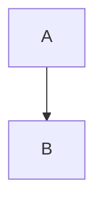

# Crazy Rich Markdown Editor

Select any text and a **floating toolbar** appears above it. This paragraph has *italic*, ~~strikethrough~~, `inline code` and a [link](https://example.com) to try things on.

## Lists

- Bullet one
- Bullet two
  - Nested bullet
- [ ] Open task
- [x] Done task

1. First
2. Second

> A quote with some wisdom in it.

```ts
// A typed greeting
const greeting: string = 'hello';
console.log(greeting.length + 42);
```



> [!NOTE]
> Useful information that users should know, even when skimming content.

> [!WARNING]
> Urgent info that needs immediate user attention to avoid problems.

Chemistry: H<sub>2</sub>O, math: E=mc<sup>2</sup>, and <ins>underlined text</ins>. Press <kbd>Ctrl</kbd> + <kbd>C</kbd>.

A footnote reference[^1].

[^1]: The footnote text.

| Name | Role |
| ---- | ---- |
| Ada  | Engineer |
| Lin  | Designer |

<details>
<summary>Raw HTML stays safe</summary>

Hidden content.

</details>

Plain symbols stay clean: snake_case, a < b, R&D and ~/code.
